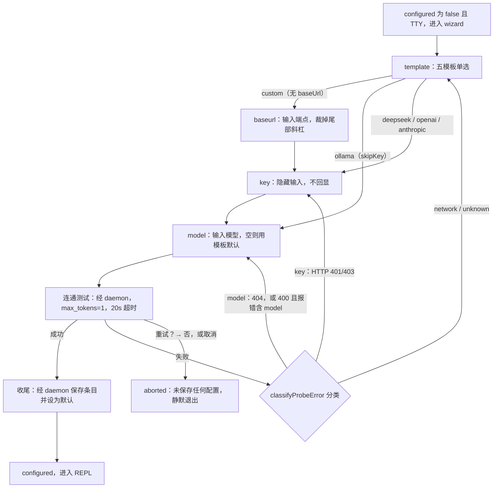

# onboarding — 首次运行体验

## 职责

`packages/cli` 的首次运行链路包含两个模块：`src/wizard.ts` 的 `runWizard` 是 30 秒配置 wizard（选模板 → 输入 key → 连通测试 → 保存为默认 provider），检测、连通测试与保存全部经由 daemon 完成；`src/web-cmd.ts` 的 `webAction` 实现 `kclaw web`（确保 daemon 在运行、附带 token 打开浏览器）。加上 `src/index.ts` 入口的 Node >= 22 版本检查，共同构成首次执行 `kclaw` 能顺利使用的全部路径。

## 设计决策

- **是否已配置只以 daemon 为准**：daemon 没有 provider 也能启动（每次 run 第一次调用模型时才解析 provider，见 [provider](../core/provider.md)），`GET /providers` 快照里的 `configured` 字段由 daemon 按自己的解析规则计算——默认 provider 的端点与模型都能解析出来（条目字段为空时取 daemon 进程的 `KCLAW_LLM_BASE_URL`/`KCLAW_LLM_MODEL`）。CLI 进程不自己读 config.json 判断：CLI 与 daemon 的环境变量可能不同，各自判断会得出不一致的结论。
- **wizard 经由运行中的 daemon 写配置**：连通测试走 `POST /providers/probe`，请求从 daemon 发出（真正调用模型的也是 daemon）；保存走 `POST /providers` 与 `POST /providers/:name/default`，daemon 写入 config.json 并发出配置变更通知，下一条消息就用上新配置，不需要重启 daemon。
- **wizard 是验证环节不是必经之路**：只在 `configured === false` 且 stdout 是 TTY 时启动；取消（Ctrl+C 等）或"重试？→否"都直接静默退出，连通测试成功之前**不保存任何配置**。
- **连通测试用最小请求**：一次 `max_tokens: 1` 的补全请求，验证 key、model、baseUrl 三项组合可用，不浪费 token。
- **key 经 daemon 保存到 credentials.json**：daemon 的 `saveConfig` 原子写入（临时文件写入后 rename，mode 0600），API key 存放在 `~/.kclaw/credentials.json`（0600，config.json 里留空串，机制见 [storage](../core/storage.md)），仅属主可读写；`/providers` 快照返回的 key 是掩码。
- **`kclaw web` 不向用户展示 token**：URL 带 token 只用于浏览器一次交接，终端打印的地址刻意去掉 `?token=` 部分（用户能看见/分享的是不带 token 的 URL）。

## 首次运行判定（packages/cli/src/index.ts 的 chatAction）

`chatAction` 先 `KclawClient.connect`（必要时启动 daemon），再读 `GET /providers` 的 `configured`：

- `configured` 不是 `false` → 直接进入 `runChat`（不带这个字段的旧 daemon 同样直接进入）。
- `false` + TTY → `runWizard(client)`；返回 `"aborted"` 时静默返回（没有保存任何配置），`"configured"` 时继续进入 chat。
- `false` + 非 TTY（管道/CI）→ 打印一行指引并返回：`尚未配置模型 provider：请在终端运行 \`kclaw chat\` 完成配置流程`。

`kclaw run` 不进入 wizard：`configured === false` 时 stderr 一行指向 `kclaw chat` 与 WebUI 的 Model 页，退出码 1（见 [cli](./cli.md) 的 kclaw run 一节）。未配置时 `kclaw web` 照常可用，在 Model 页完成配置后即可对话。

## wizard 流程（packages/cli/src/wizard.ts）

模板菜单来自 core 的 `PROVIDER_PRESETS`（与 WebUI Model 页共用的同一份预设目录）加上一个自定义项：

| id | label | format | baseUrl | 默认 model | skipKey |
|----|-------|--------|---------|-----------|---------|
| `deepseek` | DeepSeek | openai | `https://api.deepseek.com/v1` | `deepseek-chat` | |
| `openai` | OpenAI | openai | `https://api.openai.com/v1` | `gpt-4o-mini` | |
| `anthropic` | Anthropic | anthropic | `https://api.anthropic.com` | `claude-sonnet-4-5` | |
| `ollama` | Ollama (local) | openai | `http://localhost:11434/v1` | | 是（key 固定填 `"ollama"`） |
| `custom` | Custom OpenAI-compatible endpoint | openai | 无（需输入） | | |

`format` 决定连通测试与保存条目的线上协议（openai 走 OpenAI 兼容的 `/chat/completions`，anthropic 走 Anthropic Messages API）。预设里写死格式与 baseUrl，用户只需填 key 与模型，Anthropic 格式的 provider 首次运行就能配（机制见 [provider](../core/provider.md)）。

步骤机（`step: "template" | "baseurl" | "key" | "model"`）：

1. **template**：@clack 单选五模板；custom（无 baseUrl）进入 baseurl 步，ollama（skipKey）跳过 key 直达 model，其余进入 key。
2. **baseurl**（仅 custom）：文本输入，裁掉末尾斜杠，空值报错并重新输入。
3. **key**：`p.password` 隐藏输入（不回显）；ollama 不经过这步。
4. **model**：文本输入，空则用模板默认；然后构造 `buildProviderEntry(t, apiKey, model)` → `{ baseUrl, apiKey, model }` → 连通测试。
5. **连通测试**（`POST /providers/probe`，daemon 调用 core 的 `probeProviderChat`）：按模板的 `format` 做连通测试——openai 格式 `POST {baseUrl}/chat/completions`，body `{ model, messages: [{role:"user", content:"hi"}], max_tokens: 1, stream: false }`；anthropic 格式 `POST {baseUrl}/v1/messages`，body 为对应的 Messages 形态。20 秒超时；不抛异常而是原样返回 `{status, body}`（status 为 null = 请求没到达），判定与重试留在 CLI，与 provider 管理接口共用同一连通测试实现（机制见 [provider](../core/provider.md)）。成功（HTTP < 400）→ 保存收尾；失败 → 分类报错 + 重试确认。

**失败按三类报错**（`classifyProbeError` → `REASON`）：

| 判定 | 条件 | 文案 | 重试回到的步骤（`retryStepFor`） |
|------|------|------|------|
| `key` | HTTP 401/403 | API key 无效（401/403） | key 输入 |
| `model` | HTTP 404，或 400 且报错文本含 "model" | 模型名不对（404/400） | model 输入 |
| `network` | 请求根本没到达（status 为 null） | 连不上服务端（网络或 baseUrl 不通） | 模板选择（custom 的 baseUrl 并入这步） |
| `unknown` | 其余 | 未知错误 | 模板选择 |

"重试？→ 是"回到上表对应的步骤，"否"或取消 → `已退出，未做任何修改`，返回 `"aborted"`。

步骤机的分支与回退边：



**成功收尾**（`saveAsDefault`）：`POST /providers {name: tpl.id, entry}` 新建条目，同名条目已存在（409）时改用 `PATCH /providers/:name {entry}` 覆盖，再 `POST /providers/:name/default` 设为默认；daemon 原子写入 config.json 与 credentials.json 并发出配置变更通知 → `配置已保存，开始对话`，返回 `"configured"`，`chatAction` 继续进入 REPL。

## kclaw web（packages/cli/src/web-cmd.ts）

```ts
export function buildWebUrl(port: number, token: string): string
// "http://127.0.0.1:<port>/?token=<encodeURIComponent(token)>"

export function openCommandFor(platform: NodeJS.Platform): "open" | "xdg-open" | null
// darwin → "open"；linux → "xdg-open"；其余（含 win32）→ null

export async function webAction(home: string): Promise<void>
```

`webAction` 四步：

1. `ensureDaemon(home)` 确保 daemon 在运行（不在则启动，打印 `daemon started`）。
2. 读 `<home>/token`。
3. `buildWebUrl(info.port, token)` 构造 URL（token 经 URL 编码，含保留字符也能完整保留于查询参数）。
4. 有浏览器命令（macOS/Linux）→ `spawn(cmd, [url], {detached: true, stdio: "ignore"}).unref()` 以独立进程启动（CLI 不等浏览器、浏览器寿命独立于 CLI），打印 `opening <不带 token 的 URL> in your browser`；没有命令 → 直接打印 `open <完整 URL>` 让用户手动打开。

浏览器侧的接收：WebUI 启动时把 `?token=` 存进 localStorage 并从地址栏清除（`bootstrapToken`，见 [webui](../web/webui.md)）。

## Node >= 22 版本检查（packages/cli/src/index.ts）

`invokedAsMain`（作为入口执行）时，在 `program.parseAsync` **之前**检查：

```ts
const [major] = process.versions.node.split(".").map(Number)
if (major < 22) {
  console.error(`kclaw requires Node >= 22 (you are on ${process.versions.node})`)
  process.exit(1)
}
```

放在解析前的目的是让过低的 Node 运行时在报出难懂的语法/API 错误之前就得到一行明确的提示。库引用（`import "@kclaw/cli"`）不经过这段。

## 边界与出错

- **wizard 只经 daemon 的 provider 接口保存配置**：中途任何取消点都返回 `"aborted"`，什么都不保存。
- **非交互终端没有 wizard**：只打印一行指引，面向脚本/CI 场景（脚本/CI 场景不应出现交互式提问）。
- **连通测试超时 20s**：`AbortSignal.timeout` 中止请求，status 记为 null → 按 network 类报错。
- **`kclaw web` 无浏览器命令的平台**：Windows 等 `openCommandFor` 返回 null 的平台退化为打印 URL（token 完整可见，用户自行打开）。
- **token 文件缺失**：`ensureDaemon` 启动的 launch 会创建 `<home>/token`，所以 `webAction` 读它时必然存在；daemon 已在运行时该文件同样存在（token 跨重启复用，见 [daemon](../server/daemon.md)）。

## 关联

- [cli](./cli.md)：wizard 之后的 REPL、命令树全貌
- [provider](../core/provider.md)：配置保存后 daemon 如何用它构造 LLM 客户端、未配置时 daemon 怎样启动
- [daemon](../server/daemon.md)：`ensureDaemon` 的检测/启动细节、token 的生成与复用
- [webui](../web/webui.md)：`?token=` 握手在浏览器侧的接收
